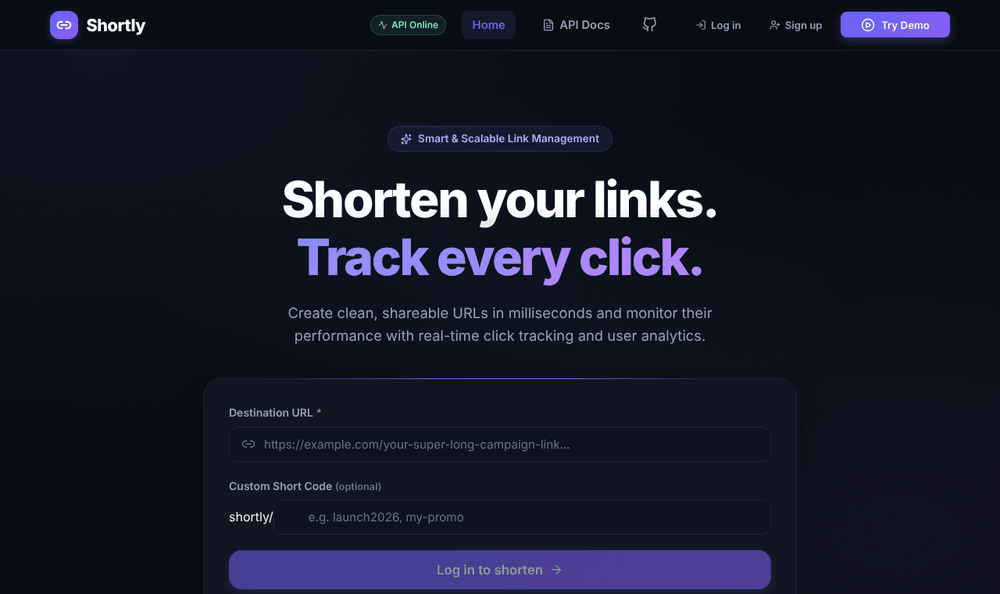
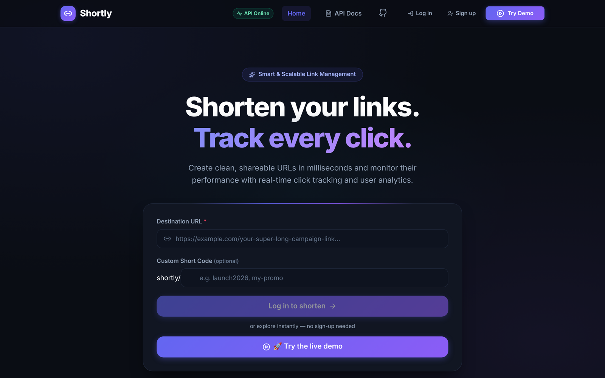
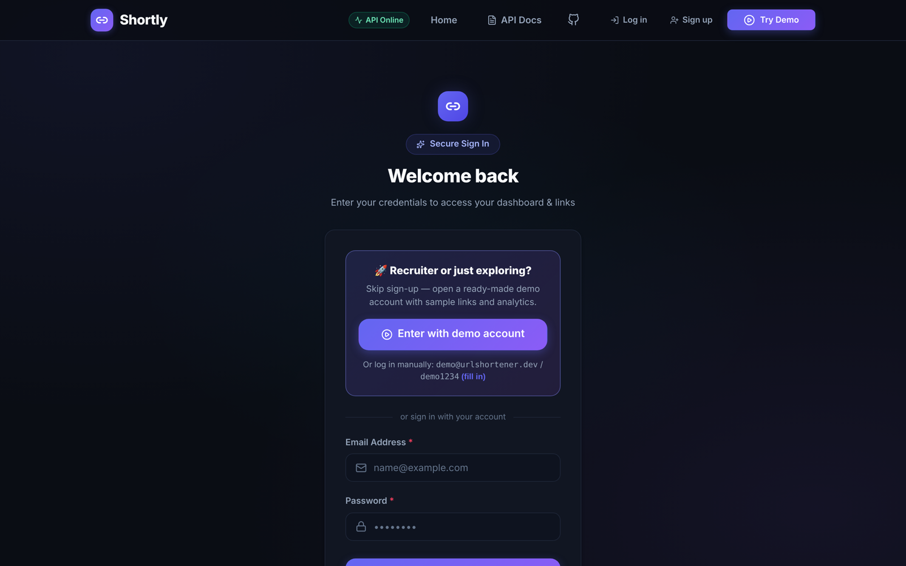
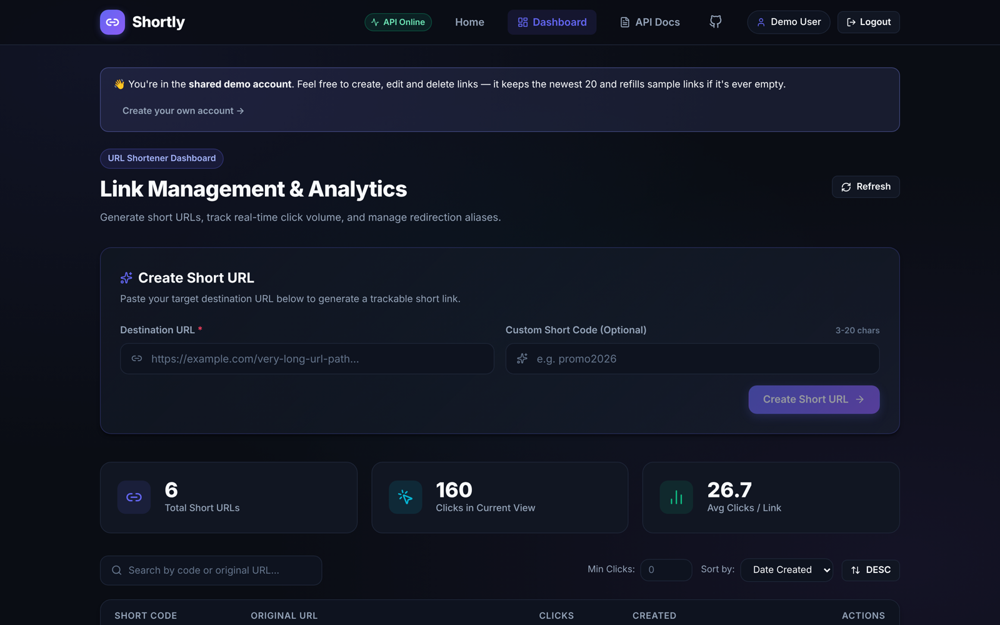
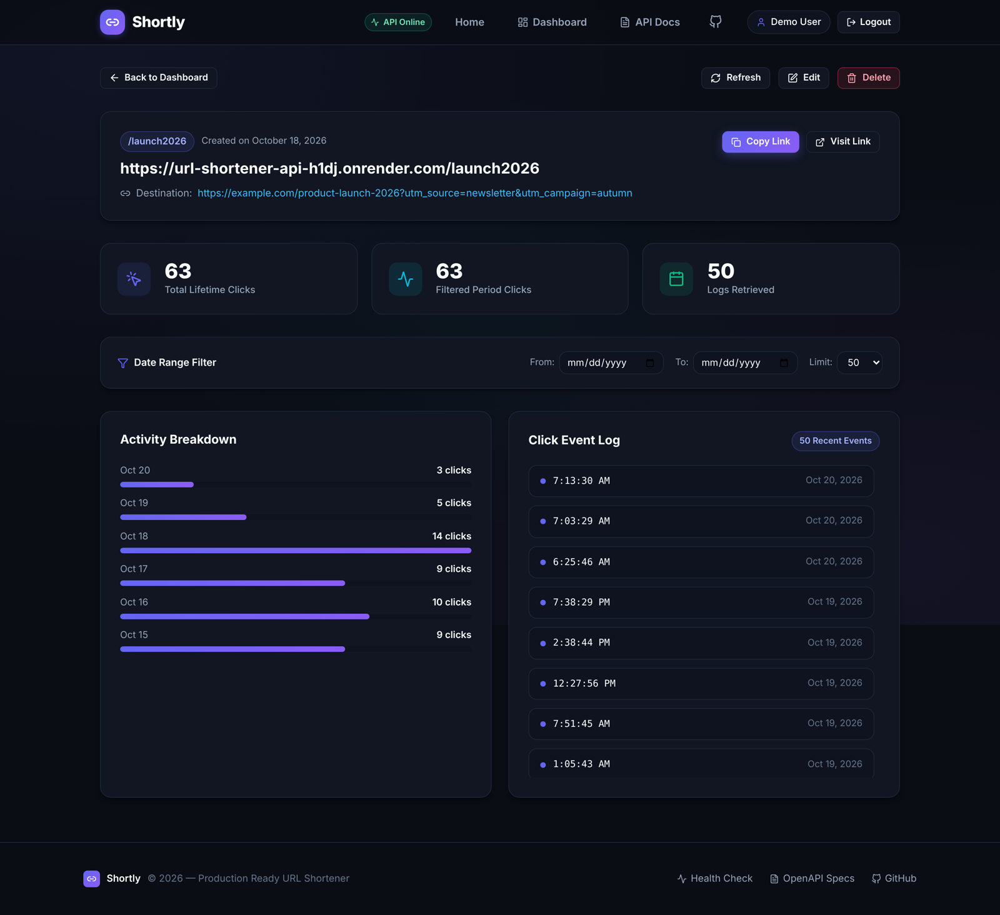
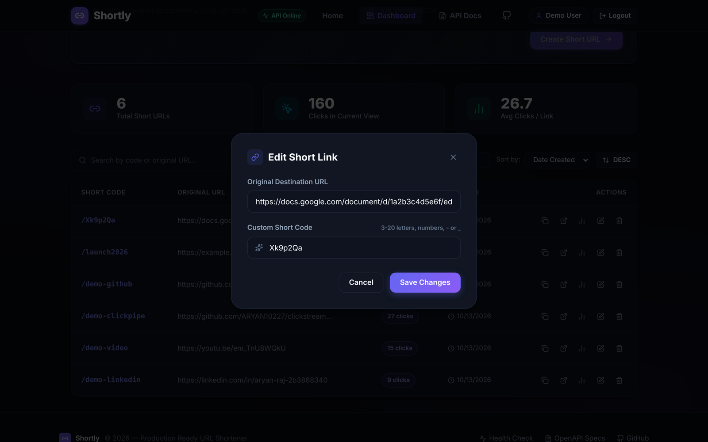
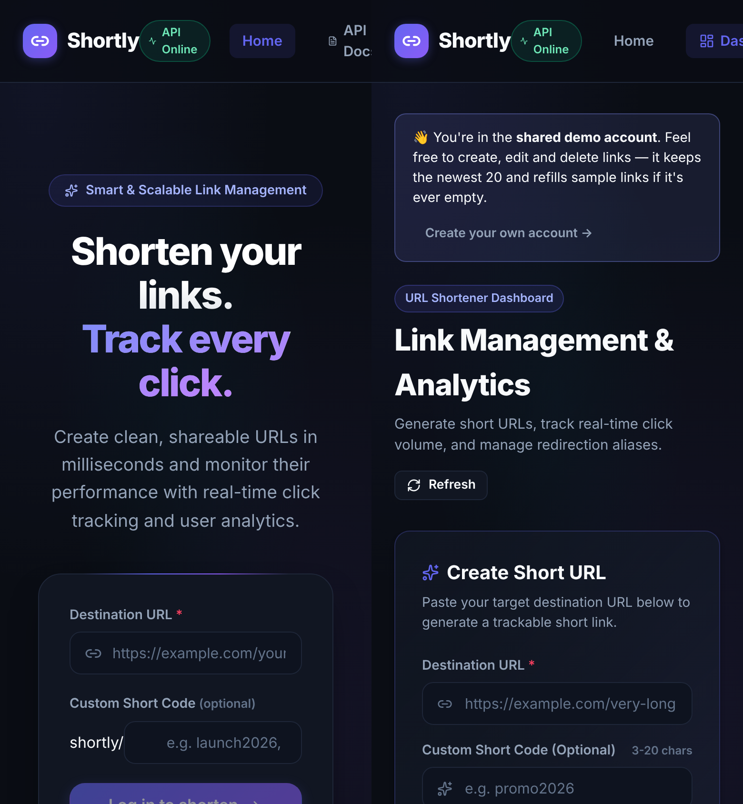
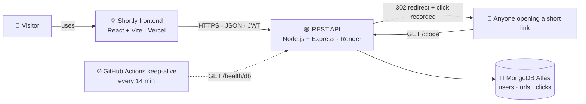

<div align="center">

# 🔗 Shortly

### Shorten links. Manage them. Track every click.

A full-stack URL shortener with JWT accounts, a link-management dashboard and per-link click analytics.
This repo is the **React frontend**; the REST API lives in [`url-shortener-api`](https://github.com/ARYAN10227/url-shortener-api).

[](https://url-shortener-frontend-t-aryan.vercel.app)
[](https://url-shortener-api-h1dj.onrender.com/api-docs)
[](https://github.com/ARYAN10227/url-shortener-api)


### 🚀 Recruiters & reviewers: click **Try Demo** — one click, no sign-up

Or log in manually with `demo@urlshortener.dev` / `demo1234`



</div>

> ⏳ The backend runs on Render's free tier. A keep-alive job pings it every 14 minutes, so it's
> normally awake; if it isn't, the app shows a "waking up" notice and the first request can take up to a minute.

---

## ✨ Features

| | |
|---|---|
| 🔗 **Shorten links** | Random 7-character codes, or your own custom alias (3–20 characters) |
| 📋 **Dashboard** | Search, sort by date / clicks / URL, filter by minimum clicks, pagination, live totals |
| ✏️ **Edit & delete** | Change a link's destination or alias; delete with a confirmation dialog |
| 📊 **Analytics** | Lifetime clicks, clicks per day, a click-event log, and date-range filtering |
| 🔐 **Accounts** | Register / log in with JWT; every user only ever sees their own links |
| 🚀 **One-click demo** | A shared demo account with sample links — visible from the navbar, home, login and register pages |
| 🛟 **Resilient UX** | "Waking up" notice for cold starts, clear errors when the API is unreachable, toast on expired sessions, no accidental logouts on slow networks |
| 📱 **Responsive** | Works on phones and desktops |

## 🖼️ Screenshots

<table>
<tr>
<td width="50%"><b>Home</b> — shorten a link or jump into the demo<br/></td>
<td width="50%"><b>Login</b> — the demo is the first thing you see<br/></td>
</tr>
<tr>
<td width="50%"><b>Dashboard</b> — all your links, clicks and actions<br/></td>
<td width="50%"><b>Analytics</b> — clicks per day and the event log<br/></td>
</tr>
<tr>
<td width="50%"><b>Edit a link</b> — new destination or alias<br/></td>
<td width="50%" align="center"><b>Mobile</b><br/></td>
</tr>
</table>

## 🧩 Architecture



| Part | Repo | Hosting |
|---|---|---|
| **Frontend** (this repo) | `url-shortener-frontend` | Vercel |
| **REST API** | [`url-shortener-api`](https://github.com/ARYAN10227/url-shortener-api) | Render (free tier) + MongoDB Atlas |
| **Click analytics pipeline** (Kafka → ClickHouse) | [`clickstream-pipeline`](https://github.com/ARYAN10227/clickstream-pipeline) | Docker / Codespaces |
| First version (Express + Redis cache) | [`url-shortener`](https://github.com/ARYAN10227/url-shortener) | — |

## 🧠 How it works

- **Auth:** the JWT is kept in `localStorage`; an Axios request interceptor adds `Authorization: Bearer …`
  to every call, and a response interceptor turns any `401` into a clean logout plus a "session expired" toast.
- **Protected routes:** `/dashboard` and `/analytics/:code` redirect to `/login` (remembering where you were
  going); the login page offers the one-click demo, so nobody gets stuck.
- **Session restore:** on load the app calls `GET /api/auth/me`. Only a real `401` clears the session —
  a timeout while the free server wakes up keeps you signed in.
- **Demo account:** `POST /api/auth/demo` returns a token for a shared account. The API keeps it to its newest
  20 links and re-creates sample links if it's ever emptied.

## 🛠️ Tech stack

React 19 · Vite 8 · React Router 7 · Axios · lucide-react icons · a hand-written CSS design system (no UI
framework) · ESLint · Vercel

## 🚀 Run locally

```sh
git clone https://github.com/ARYAN10227/url-shortener-frontend.git
cd url-shortener-frontend
npm install
cp .env.example .env       # set VITE_API_URL=http://localhost:3000 to use a local API
npm run dev                # → http://localhost:5173
```

| Script | What it does |
|---|---|
| `npm run dev` | Dev server with hot reload |
| `npm run build` | Production build into `dist/` |
| `npm run preview` | Serve the production build locally |
| `npm run lint` | ESLint |

| Variable | Default | Purpose |
|---|---|---|
| `VITE_API_URL` | `https://url-shortener-api-h1dj.onrender.com` | Base URL of the REST API |

## 📁 Project structure

```
src/
├── pages/        Landing, Login, Register, Dashboard, Analytics
├── components/   Navbar, Footer, Edit/Delete/Analytics modals, DemoLoginButton,
│                 ServerWakeNotice, ProtectedRoute, Toast
├── context/      AuthProvider (session, login, demo, logout), ToastProvider
├── services/     api.js — Axios client, token storage, every API call
└── index.css     Design tokens and components
```

## 🌐 Deployment

- Hosted on **Vercel**; every push to `main` deploys automatically, and pull requests get preview URLs.
- `vercel.json` rewrites every path to `index.html`, so client-side routes survive a page refresh.
- **Deployment Protection is off** for production — otherwise visitors are sent to a Vercel login page.

---

<div align="center">

### 👋 Built by Aryan Raj

[](https://github.com/ARYAN10227)
[](https://linkedin.com/in/aryan-raj-2b3868340)
[](mailto:aryanrajpersonal12@gmail.com)

⭐ If you like this project, consider giving it a star!

</div>
